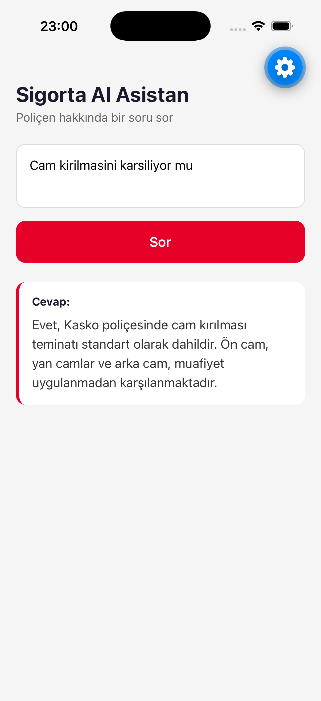

# llm-adapter-kit 🧩

Hey! 👋 This is a little project I built to really *understand* how to work with LLMs in a clean, provider-agnostic way — not just call an API and hope for the best.

The idea: build an AI layer that doesn't lock you into a single provider, keeps costs sane, and doesn't make things up. Then wire it all the way up to a real mobile app.

## Demo



## What it does

You ask an insurance question on your phone → the app hits a backend → the backend finds the relevant policy document, picks the right model for the job, and answers based on that document. If it doesn't know, it says so instead of hallucinating.

## The architecture (and why)

- **Adapter pattern** — every LLM provider (Gemini, a mock for testing) is wrapped behind one shared `LLMProvider` interface. The rest of the app never knows *which* provider it's talking to. Swap providers → write one adapter, change nothing else.
- **Factory** — one place decides how each adapter gets built. The app just asks for `"gemini"`, the factory hands back a ready provider.
- **Strategy** — picks the model based on the task. Simple questions go to a cheap/fast model, harder ones to a stronger model. Cost-aware by design.
- **Orchestration** — chaining (multi-step pipelines), routing (classify a request, send it down the right path), and a multi-turn **agent loop** that uses the provider's native function calling to decide which tools to call. Tools are declared once in a provider-neutral format; the Gemini adapter translates them.
- **RAG** — embedding-based semantic search (Gemini embeddings + cosine similarity) finds the relevant documents *before* answering, so the model responds from real content and hallucinates far less. It matches by meaning, not keywords: "ön camım çatladı" still finds the windshield document. Answers cite their source documents. No matching doc? It says "I don't know."
- **Resilience** — retries transient errors (rate limits, 5xx, network) with exponential backoff, and fails fast on permanent ones like an invalid key. If a provider keeps failing, it falls back to the next one. If every provider is down, the app gets an honest "try again later", never a made-up answer.
- **Backend proxy** — the API key lives on the server, never on the device. The mobile app only ever talks to my own backend.
- **Streaming** — the answer appears on the phone as it's generated. Every provider can stream, the backend sends the sources first and then the answer chunk by chunk as NDJSON (`POST /ask/stream`), and the app reads it with `expo/fetch`. Fallback still works for streams, until the first chunk arrives.
- **React Native app** — a real Expo app that ties it all together, end to end.

## Tech

TypeScript · Node/Express · Google Gemini · React Native (Expo)

## Running it

```bash
# 1. Backend (needs a GEMINI_API_KEY in .env)
npx tsx server/index.ts

# 2. Mobile app
cd mobile
npx expo start
```

## Current limitations

- Only one real provider (Gemini) so far, so the fallback chain has nothing to fall back to yet. The Mock is used for testing only.
- The knowledge base is a small in-memory set of documents, not a vector database.
- The backend exposes the RAG flow; chaining, routing and the agent are runnable examples that aren't served by the API yet.
- Single backend instance, no conversation history yet.

## What I learned

Building this taught me way more than reading about design patterns ever did — especially how the same abstractions (adapter, strategy) keep the messy provider-specific details out of the way as the system grows.
